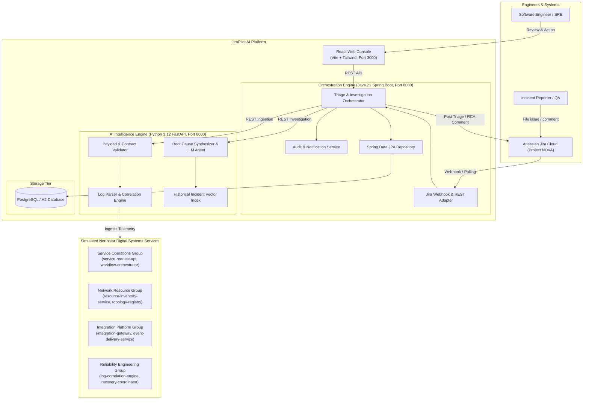
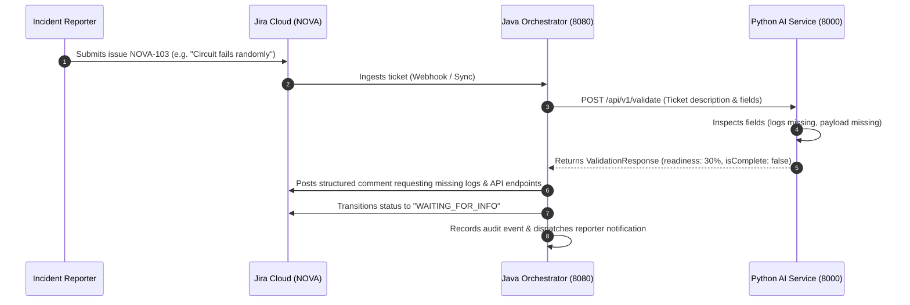
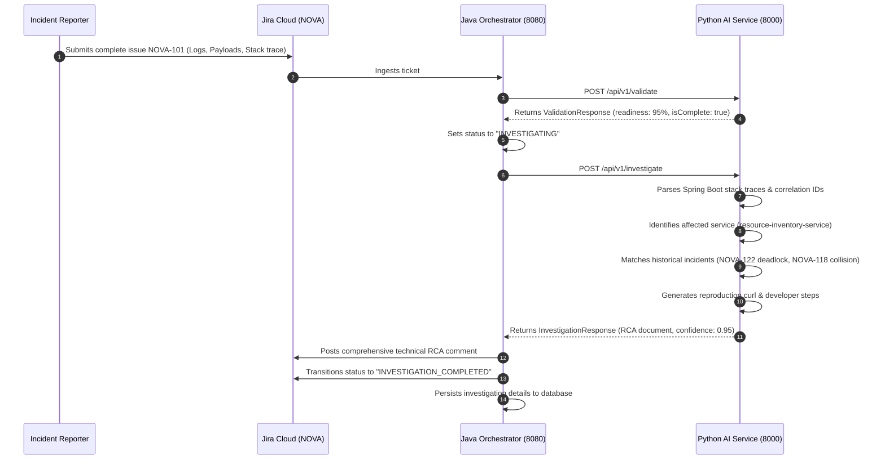

# JiraPilot AI - Architecture & System Design
**Fictional Organization:** Northstar Digital Systems (`northstar-labs`)  
**Product:** JiraPilot AI (Synthetic Jira Project: `NOVA`)  
**Document Version:** 1.0.0 (Public-Safe Synthetic Architecture)

---

## 1. System Vision & Overview

**JiraPilot AI** is an autonomous engineering productivity and incident triage platform built for **Northstar Digital Systems**. When Jira issues are filed against simulated enterprise services (such as `resource-inventory-service` or `workflow-orchestrator`), JiraPilot AI:

1. **Evaluates Ticket Readiness:** Parses the issue to ensure sufficient investigation data exists (logs, payloads, API endpoints, errors, expected vs. actual behaviors).
2. **Autonomous Clarification Loop:** If critical information is missing, it calculates a readiness score, posts a structured triage comment to Jira, and places the ticket into `WAITING_FOR_INFO`.
3. **Deep AI Investigation:** If sufficient data exists, it correlates distributed logs, identifies affected APIs, analyzes payloads, synthesizes root causes with high confidence, produces developer reproduction curl commands, and outputs an enterprise Root Cause Analysis (RCA).
4. **Interactive Dashboard:** Streams investigation telemetry and real-time status to an enterprise operations console.

---

## 2. High-Level Architecture (C4 Model)

---

## 3. Sequence & Data Flow

### 3.1 Workflow A: Incomplete Ticket Triage

### 3.2 Workflow B: Complete Ticket Investigation & RCA Synthesis

---

## 4. Component Responsibilities

### 4.1 Java Backend Orchestrator (`backend/`)
* **Technology:** Java 21, Spring Boot 3.2.5, Maven, Spring Data JPA, Spring Web.
* **Responsibilities:**
  * Jira Cloud REST API integration (issue fetch, comment post, status transition).
  * Webhook listener and scheduled poller.
  * State lifecycle management (`OPEN`, `WAITING_FOR_INFO`, `INVESTIGATING`, `COMPLETED`).
  * Inter-service REST orchestration with the Python AI service.
  * Audit logging and email notification workflows.
  * Dashboard REST endpoints (`/api/tickets`, `/api/tickets/{key}`, `/api/audit-logs`).

### 4.2 Python AI Intelligence Service (`ai-service/`)
* **Technology:** Python 3.12, FastAPI, Pydantic, httpx, jsonschema.
* **Responsibilities:**
  * Semantic ticket completeness validation (`/api/v1/validate`).
  * Distributed log parsing, regex timestamp alignment, and stack trace parsing (`/api/v1/logs/parse`).
  * Microservice API endpoint mapping from Northstar Service Catalog.
  * RCA synthesis and synthetic reproduction payload generation (`/api/v1/investigate`).
  * Vector similarity search across synthetic historical incidents (`/api/v1/incidents/similar`).

### 4.3 Frontend Web Console (`frontend/`)
* **Technology:** React 18, TypeScript, Vite, Tailwind CSS, Lucide icons.
* **Responsibilities:**
  * Clean, high-density enterprise dashboard (inspired by Linear and Notion).
  * Real-time ticket table with readiness scores, service badges, and status pills.
  * Deep-dive investigation view (stack traces, reproduction curl, historical incident comparisons).
  * Manual trigger controls: "Sync Jira", "Run AI Investigation", "Notify Reporter".
