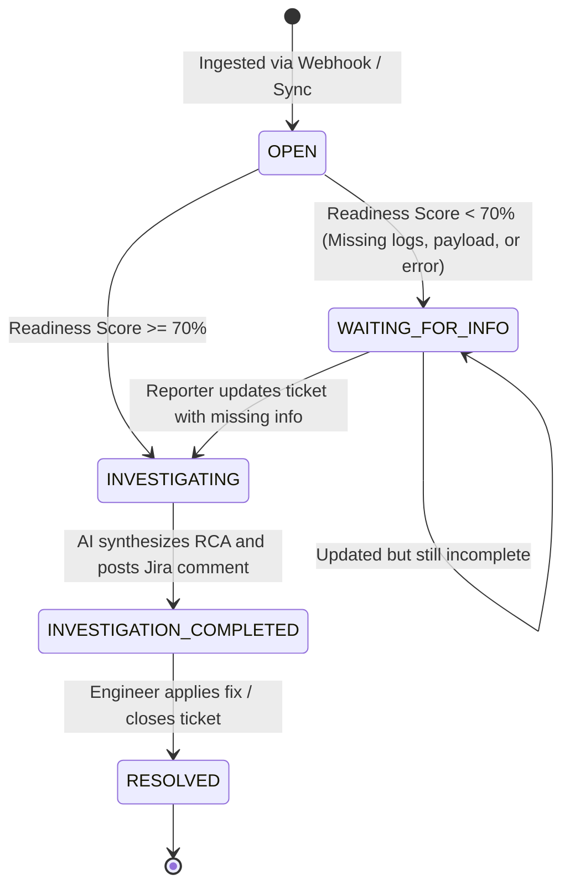

# JiraPilot AI - Data Dictionary & Domain Entities
**Fictional Organization:** Northstar Digital Systems  
**Product:** JiraPilot AI  
**Scope:** Authoritative domain dictionary, database entities, lifecycle enumerations, and field validation rules.

---

## 1. Domain Entities & Database Schema

### 1.1 `Ticket` (`jira_tickets` table)
Primary record representing an incident ticket ingested from Atlassian Jira Cloud or simulated test harnesses.

| Field Name | Type | Nullable | Description & Constraints |
| :--- | :--- | :--- | :--- |
| `id` | `BIGINT` | No | Auto-incrementing primary key. |
| `ticket_key` | `VARCHAR(32)` | No | Unique issue key (e.g. `NOVA-101`, `KAN-4`). Unique constraint. |
| `title` | `VARCHAR(255)` | No | Summary/title of the incident ticket. |
| `description` | `TEXT` | Yes | Raw textual description provided by the reporter. |
| `status` | `VARCHAR(32)` | No | Current lifecycle status enum. See Section 2. |
| `service` | `VARCHAR(64)` | Yes | Inferred or assigned Northstar service ID (e.g. `resource-inventory-service`). |
| `environment` | `VARCHAR(32)` | Yes | Target deployment tier: `development`, `staging`, `production-simulation`. |
| `readiness_score`| `DOUBLE` | No | Completeness percentage (0.0 to 100.0) computed by AI validator. |
| `is_complete` | `BOOLEAN` | No | True if readiness score >= 70.0 and all mandatory fields exist. |
| `reporter_email` | `VARCHAR(128)` | Yes | Email address of the issue reporter for notifications. |
| `api_details` | `TEXT` | Yes | HTTP method and path identified in the report. |
| `logs` | `TEXT` | Yes | Raw logs or stack traces pasted in ticket. |
| `request_payload`| `TEXT` | Yes | JSON or XML request body submitted by client. |
| `response_payload`| `TEXT` | Yes | Server response body returned during failure. |
| `error_message` | `TEXT` | Yes | Explicit error string, exception name, or failure message. |
| `correlation_id`| `VARCHAR(64)` | Yes | Synthetic distributed tracing correlation ID (`CORR-DEMO-XXXX`). |
| `created_at` | `TIMESTAMP` | No | UTC timestamp when ticket was created in Jira. |
| `updated_at` | `TIMESTAMP` | No | UTC timestamp of last status or content modification. |

---

### 1.2 `InvestigationResult` (`investigation_results` table)
Generated when a ticket is determined to be complete and processed through the Python AI engine.

| Field Name | Type | Nullable | Description |
| :--- | :--- | :--- | :--- |
| `id` | `BIGINT` | No | Primary key. |
| `ticket_id` | `BIGINT` | No | Foreign key referencing `jira_tickets(id)`. |
| `probable_failure_point` | `VARCHAR(255)` | Yes | Identified class, method, or subsystem where error originated. |
| `probable_root_cause` | `TEXT` | No | Technical analysis explaining why the failure occurred. |
| `confidence_score` | `DOUBLE` | No | Statistical confidence score between 0.00 and 1.00. |
| `reproduction_curl` | `TEXT` | Yes | Public-safe synthetic curl command to reproduce error. |
| `reproduction_steps` | `TEXT` | Yes | Step-by-step developer reproduction checklist. |
| `investigation_steps`| `TEXT` | Yes | Suggested troubleshooting steps for SREs. |
| `test_cases` | `TEXT` | Yes | Suggested unit/integration test names and assertions. |
| `rca_document` | `TEXT` | Yes | Full Markdown Root Cause Analysis report. |
| `jira_comment_markdown`| `TEXT` | Yes | Formatted markdown comment posted to Jira. |
| `created_at` | `TIMESTAMP` | No | UTC generation timestamp. |

---

### 1.3 `AuditEvent` (`audit_events` table)
Immutable audit trail tracking all automated actions taken by JiraPilot AI.

| Field Name | Type | Nullable | Description |
| :--- | :--- | :--- | :--- |
| `id` | `BIGINT` | No | Primary key. |
| `ticket_key` | `VARCHAR(32)` | No | Reference to target ticket key. |
| `event_type` | `VARCHAR(64)` | No | Enum: `TICKET_INGESTED`, `READINESS_EVALUATED`, `WAITING_COMMENT_POSTED`, `RCA_COMMENT_POSTED`, `EMAIL_NOTIFIED`. |
| `actor` | `VARCHAR(64)` | No | System agent identifier (e.g. `JiraPilot-AI-Agent`). |
| `details` | `TEXT` | Yes | JSON or summary description of action taken. |
| `timestamp` | `TIMESTAMP` | No | UTC event occurrence timestamp. |

---

## 2. Ticket State Machine Lifecycle

### State Definitions
* **`OPEN`:** Fresh ticket imported into system; awaiting initial automated triage evaluation.
* **`WAITING_FOR_INFO`:** Evaluated by AI; missing critical information (e.g., logs, request payload). Automated comment posted requesting missing data; reporter notified.
* **`INVESTIGATING`:** All required fields present; deep log correlation and root cause synthesis currently underway.
* **`INVESTIGATION_COMPLETED`:** RCA synthesized, developer reproduction steps generated, structured investigation comment published to Jira Cloud.
* **`RESOLVED`:** Incident resolved by engineering team.
