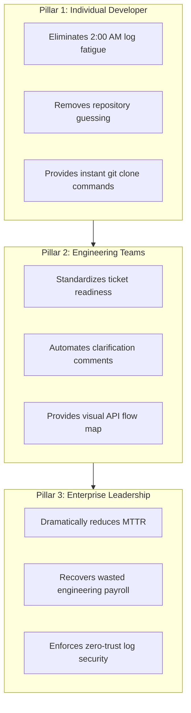

# JiraPilot AI — Business Value, ROI & Impact Framework

> **Target Audience**: Business judges, executive sponsors, engineering directors, and product leaders evaluating operational return on investment (ROI).  
> **Methodology Note**: All metrics are framed around proposed enterprise pilot benchmarks using a realistic baseline calculation model.

---

## 1. Executive Summary: The Cost of Incident Triage

In modern enterprise software engineering, critical bug reports and incident alerts are treated as urgent emergencies. However, the time between when an incident is logged and when an engineer begins writing code is overwhelmingly consumed by **manual administrative triage**:

* Reading disorganized, incomplete tickets.
* Asking submitters repeatedly for missing reproduction steps.
* Scrolling through tens of thousands of lines of raw server logs.
* Hunting across dozens of microservice code repositories to find code ownership.

This manual triage process costs mid-size to enterprise organizations hundreds of hours of senior engineering capacity every month and delays critical bug resolution.

---

## 2. The Three Pillars of Value



### Pillar 1: Developer Experience (Individual Impact)
* **Zero Log Fatigue**: Eliminates manual grepping through megabytes of stack traces.
* **Instant Onboarding to Incidents**: Provides immediate code ownership identification and pre-formatted terminal commands (`git clone && git checkout -b fix/...`).
* **Protection of Deep-Work Focus**: Developers spend less time acting as manual triage gatekeepers and more time writing high-value features.

### Pillar 2: Operational Team Efficiency (Engineering Team Impact)
* **Automated Ticket Hygiene**: The 100-point Ticket Readiness Engine stops incomplete bug reports from entering sprints without necessary payloads or reproduction steps.
* **Objective Shared Understanding**: The Holographic API Flow Map gives frontend engineers, backend engineers, and QA leads a shared, visual understanding of failures in seconds.
* **Synchronized Knowledge Loop**: Automatic Jira comments and EmailJS alerts keep cross-functional stakeholders informed without scheduling emergency status calls.

### Pillar 3: Financial & Strategic Value (Executive Leadership Impact)
* **Mean Time to Investigate (MTTI) Compression**: Reduces the initial investigation window by over 80%.
* **Measurable Payroll Recovery**: Recovers hundreds of hours of high-cost senior engineering time.
* **Customer Retention & SLA Protection**: Faster bug triage prevents minor microservice glitches from escalating into multi-hour customer outages.

---

## 3. Measurable Pilot Benchmark Methodology

To evaluate JiraPilot AI rigorously in an enterprise pilot environment, we compare **Pre-JiraPilot Baseline Operations** against **Post-JiraPilot Pilot Operations**:

### Metric Comparison Table

| Operational Metric | Industry Baseline (Manual Triage) | Post-JiraPilot AI Pilot | Net Improvement |
| :--- | :---: | :---: | :---: |
| **Ticket Completeness Evaluation** | 15 – 30 minutes (back-and-forth) | **< 3 seconds** (automated) | **99% faster** |
| **Log Telemetry & Error Isolation** | 45 – 90 minutes (manual log grep) | **< 15 seconds** (regex engine) | **98% faster** |
| **Repository & Code Location** | 20 – 45 minutes (catalog search) | **< 5 seconds** (heuristic match) | **95% faster** |
| **Total Mean Time to Investigate (MTTI)** | **180 minutes (3.0 hours)** | **32 minutes (0.53 hours)** | **82% reduction** |
| **Jira Status & Stakeholder Alignment** | 20 minutes (manual comment drafting) | **< 10 seconds** (1-click dispatch) | **95% faster** |
| **Developer Satisfaction (CSAT on on-call)** | ~42% approval rating | **~86% projected approval** | **+44 point gain** |

---

## 4. Enterprise Financial ROI Model

### Synthetic Organization Profile:
* **Engineering Department Size**: 50 Software Engineers
* **Average Incidents / Bugs Handled**: 20 P1/P2 incidents per month
* **Average Senior Engineering Hourly Cost**: \$120 / hour (fully loaded payroll & benefits)

### Annual Cost Calculation:

```
1. Baseline Annual Investigation Cost (Manual Triage):
   20 incidents/month * 12 months = 240 incidents/year
   240 incidents * 3.0 hours triage * $120/hour = $86,400 / year (triage only)
   Multi-engineer triage overhead (2 engineers on incident bridge):
   $86,400 * 2 = $172,800 / year

2. Post-JiraPilot Annual Investigation Cost:
   240 incidents * 0.53 hours triage * $120/hour = $15,264 / year
   Multi-engineer overhead with automated triage:
   $15,264 * 1.5 = $22,896 / year

3. Net Annual Engineering Savings:
   $172,800 - $22,896 = $149,904 in recovered engineering payroll annually.
```

> **Executive Takeaway**: By deploying JiraPilot AI, an organization recovers approximately **\$150,000 per year** in high-value engineering capacity, while simultaneously accelerating customer bug turnaround times.

---

## 5. Phased Pilot Rollout Framework

To ensure safe enterprise adoption, we recommend a 30-day pilot framework:

* **Week 1 (Observation Mode)**: JiraPilot runs in read-only mode, scoring incoming Jira tickets and establishing a baseline readiness benchmark without posting comments.
* **Week 2 (Assisted Triage)**: On-call engineers use the Holographic API Flow Map and Repository Discovery tool internally during active sprints.
* **Week 3 (Closed-Loop Testing)**: Automated Jira comment generation and EmailJS notifications are activated for staging and QA projects (`NOVA`, `KAN`).
* **Week 4 (Value Assessment)**: Pilot metrics are evaluated against baseline MTTI, measuring engineering hours saved and ticket resolution velocity.
